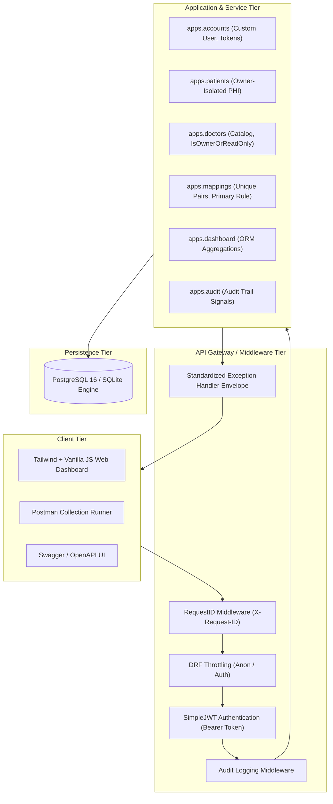
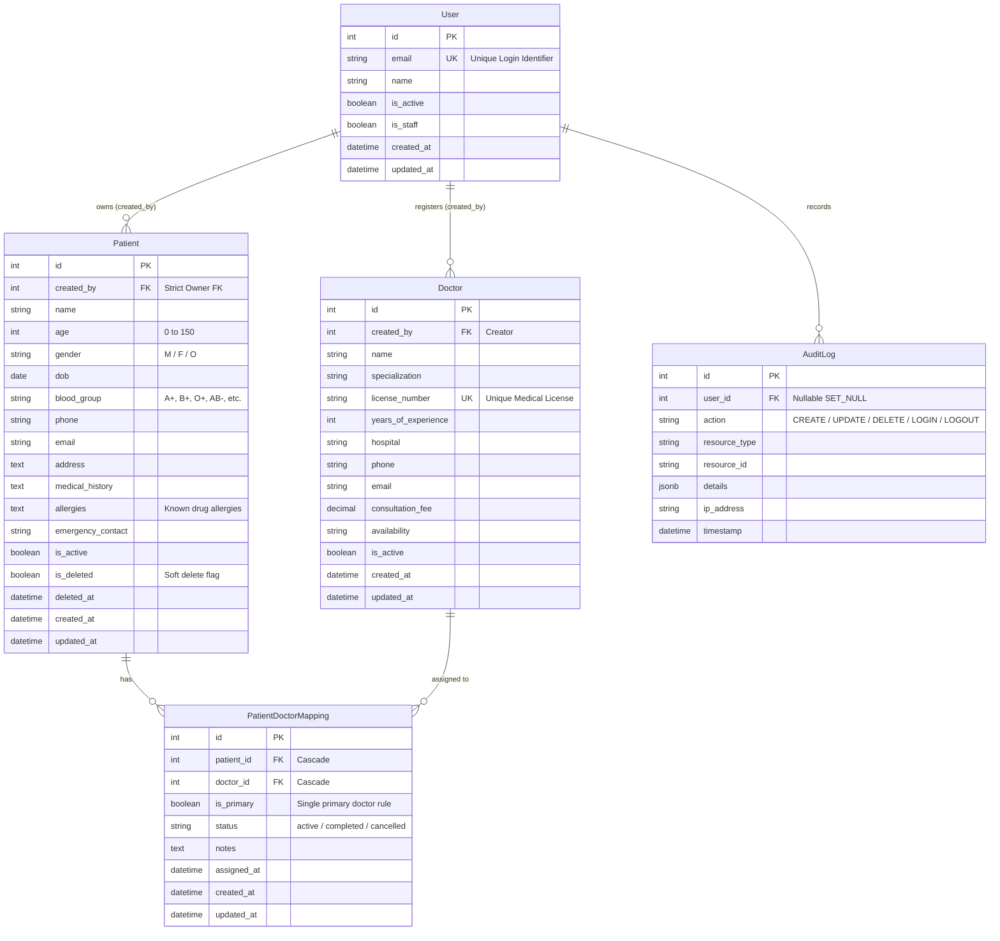

<div align="center">

# MediTrack — Clinical Operations & Healthcare Management Platform

[](https://python.org)
[](https://djangoproject.com)
[](https://www.django-rest-framework.org)
[](https://www.postgresql.org)
[](https://django-rest-framework-simplejwt.readthedocs.io)
[](https://drf-spectacular.readthedocs.io)
[](https://pytest.org)
[](https://docker.com)
[](https://github.com/astral-sh/ruff)

**MediTrack** is an enterprise-grade, HIPAA-ready clinical healthcare management platform and provider portal. Built with **Django 5**, **Django REST Framework**, **PostgreSQL 16**, and **Tailwind CSS**, it delivers cryptographic JWT authentication with token rotation, tenant-isolated patient health information (PHI), intelligent multi-specialty physician-patient mapping, an immutable security audit trail, and interactive operational telemetry.

[Interactive Swagger Docs](http://localhost:8000/api/docs/) • [Postman Collection Guide](docs/POSTMAN_GUIDE.md) • [System Health](http://localhost:8000/api/health/)

</div>

---

## 🌟 Key Features

### 1. Robust Core Architecture
- **Email-First Authentication**: Custom `User` model inheriting from `AbstractUser` with email as the unique identifier (`USERNAME_FIELD = "email"`), provisioned before initial migrations.
- **Cryptographic JWT Management**: Short-lived access tokens (15 mins), rotating refresh tokens (7 days), and automated token blacklisting upon rotation and logout via `djangorestframework-simplejwt`.
- **Tenant & PHI Owner Isolation**: Strict row-level isolation on all patient endpoints. Patient records are strictly scoped to `created_by = request.user`. Attempting to access or mutate records belonging to other users immediately raises a clean `404 Not Found` (strictly concealing existence).
- **Physician Catalog & RBAC**: Authenticated clinicians can browse the entire directory of medical doctors across specializations, while only the original creator may edit or delete doctor profiles (`IsOwnerOrReadOnly`).
- **Care Continuity Mappings**:
  - Assign physicians to patients with enforced multi-column uniqueness `(patient, doctor)`.
  - Duplicate assignments return a clean, structured `400 Bad Request` (`DUPLICATE_ENTRY`).
  - **Enforced Primary Physician Rule**: Patients can have at most one designated primary physician; assigning a new primary doctor cleanly demotes any previous primary physician within an atomic database transaction.

### 2. Standout Extra Features
- **Standardized Response Envelopes**: All API responses conform to a unified contract:
  - **Success**: `{ "success": true, "message": "...", "data": { ... } }`
  - **Error**: `{ "success": false, "error": { "code": "...", "message": "...", "details": { ... } } }`
- **Interactive OpenAPI & Swagger**: Live interactive docs at `/api/docs/` and ReDoc at `/api/redoc/` via `drf-spectacular` with working JWT "Authorize" bearer injection.
- **Real-Time Operational Analytics**: `/api/dashboard/stats/` uses optimized ORM aggregations (`Count`, `TruncMonth`, `annotate`) to avoid N+1 queries, computing total patients, doctors, care pairs, unassigned intake backlogs, and a 6-month admissions trend.
- **Soft Delete with Audit Trail**: Patients support soft-deletion via `DELETE /api/patients/<id>/?soft=true` (retaining full audit history) alongside default hard deletions.
- **Security Audit Trail**: Lightweight `AuditLog` model and Django signals capturing user, action (`CREATE`, `UPDATE`, `DELETE`, `LOGIN`, `LOGOUT`), resource, IP address, and payload.
- **Anti-Bruteforce Throttling**: DRF `ScopedRateThrottle` applied to `/api/auth/` (15 req/min) and anonymous endpoints.
- **Traceability**: Unique `X-Request-ID` attached to every request/response cycle for distributed tracing.
- **1-Click Clinical Seeding**: Management command `python manage.py seed_demo` generating realistic demo accounts, 10 specialized doctors, 15 rich patients, and active care mappings.
- **Automated Test Suite**: 32 automated tests passing with **92% code coverage** (`pytest-django` + `pytest-cov`).

### 3. Modern Single-Brand Frontend
- **Zero-Build Architecture**: Server-rendered Django templates + Tailwind CSS via CDN + modular Vanilla JS (`api.js`, `auth.js`, `ui.js`, `dashboard.js`, `patients.js`, `doctors.js`, `mappings.js`, `app.js`). Zero Node.js build step needed.
- **Medical-Tech Design System**: Calm teal/emerald primary (`#0D9488`), deep slate typography, rounded-2xl cards, subtle shadows, and glassmorphism.
- **Full Dark Mode**: Persisted across sessions via `localStorage` with system preference detection.
- **Micro-Interactions**: Hover lifts, button loading states, animated KPI counters, Chart.js graphs, slide-over form drawers, and confirmation modals.
- **Keyboard Shortcuts**: Press `/` to focus search; press `n` to register a new patient; press `Escape` to dismiss drawers.

---

## 🏛️ System Architecture



---

## 🧬 Entity-Relationship Diagram (ERD)



---

## 📡 REST API Endpoint Registry

All API endpoints return standard envelopes:
- **Success shape**: `{ "success": true, "message": "...", "data": { ... } }`
- **Error shape**: `{ "success": false, "error": { "code": "...", "message": "...", "details": { ... } } }`

| Method | Endpoint | Description | Auth Required | Permissions & Rules |
|---|---|---|---|---|
| `POST` | `/api/auth/register/` | Register new user account | Public | Throttled (15/min); validates password confirmation & strength |
| `POST` | `/api/auth/login/` | Obtain access & refresh JWTs | Public | Throttled (15/min); authenticates via email & password |
| `POST` | `/api/auth/token/refresh/` | Rotate access token | Public | SimpleJWT rotation & blacklist validation |
| `POST` | `/api/auth/logout/` | Terminate session & blacklist token | Authenticated | Blacklists refresh token; logs audit event |
| `GET` | `/api/auth/me/` | Current user profile | Authenticated | Returns authenticated user details |
| `PATCH`| `/api/auth/me/` | Update profile | Authenticated | Updates display name |
| `GET` | `/api/patients/` | List user's patients | Authenticated | **Owner-only**: Strictly filters `created_by=request.user` |
| `POST` | `/api/patients/` | Register new patient | Authenticated | Auto-attaches `created_by=request.user`; validates age 0–150 |
| `GET` | `/api/patients/<id>/` | Retrieve patient record | Authenticated | **Owner-only**: Returns 404 for other users' records |
| `PUT` | `/api/patients/<id>/` | Replace patient record | Authenticated | **Owner-only**: Returns 404 for other users' records |
| `PATCH`| `/api/patients/<id>/` | Partial update patient | Authenticated | **Owner-only**: Returns 404 for other users' records |
| `DELETE`| `/api/patients/<id>/` | Delete patient | Authenticated | **Owner-only**: Hard delete by default; soft delete if `?soft=true` |
| `GET` | `/api/doctors/` | List doctor catalog | Authenticated | All authenticated users can view/search/filter |
| `POST` | `/api/doctors/` | Register doctor | Authenticated | Auto-attaches `created_by=request.user`; license number unique |
| `GET` | `/api/doctors/<id>/` | Retrieve doctor details | Authenticated | Readable by all authenticated clinicians |
| `PUT` | `/api/doctors/<id>/` | Replace doctor details | Authenticated | `IsOwnerOrReadOnly`: 403 Forbidden for non-creators |
| `PATCH`| `/api/doctors/<id>/` | Update doctor details | Authenticated | `IsOwnerOrReadOnly`: 403 Forbidden for non-creators |
| `DELETE`| `/api/doctors/<id>/` | Remove doctor profile | Authenticated | `IsOwnerOrReadOnly`: 403 Forbidden for non-creators |
| `GET` | `/api/mappings/` | List patient-doctor mappings | Authenticated | Scoped strictly to the requesting user's patients |
| `POST` | `/api/mappings/` | Assign doctor to patient | Authenticated | Validates patient belongs to user; enforces unique `(patient, doctor)`; single primary doctor rule |
| `GET` | `/api/mappings/<patient_id>/` | Get assigned doctors for patient | Authenticated | Scoped to patient owner; returns 404 for others' patients |
| `DELETE`| `/api/mappings/<id>/` | Remove doctor assignment | Authenticated | Removes mapping by ID; scoped to patient owner |
| `GET` | `/api/dashboard/stats/` | Aggregated analytics & KPIs | Authenticated | ORM aggregation: counts, unassigned patients, 6-mo trend |
| `GET` | `/api/audit/` | View user audit trail | Authenticated | Read-only activity log for the current tenant |
| `GET` | `/api/health/` | Service health check | Public | Verifies DB connectivity and system uptime |
| `GET` | `/api/docs/` | Swagger UI documentation | Public | Interactive OpenAPI UI with JWT Authorize button |
| `GET` | `/api/redoc/` | ReDoc API documentation | Public | Alternative clean documentation renderer |

---

## 🚀 Quick Start Guide

### Option A: Docker (One Command) — Recommended

Ensure Docker and Docker Compose are installed.

```bash
# 1. Clone repository
git clone <repo-url>
cd Clinix

# 2. Copy environment template
cp .env.example .env

# 3. Build and launch services
docker compose up --build
```

**That's it!** Docker Compose will:
1. Launch a **PostgreSQL 16-alpine** container with healthchecks and persistent storage.
2. Build the multi-stage **Python 3.12** application container.
3. Automatically apply all database migrations.
4. Automatically run `seed_demo` creating realistic test data.
5. Serve the application at **`http://localhost:8000`**.

---

### Option B: Local Setup (Without Docker)

Prerequisites: Python 3.12+ installed.

```bash
# 1. Clone and enter directory
cd Clinix

# 2. Create and activate virtual environment
python -m venv venv
# Windows:
.\venv\Scripts\activate
# Linux/macOS:
source venv/bin/activate

# 3. Install dependencies
pip install -r requirements.txt

# 4. Copy environment file
cp .env.example .env

# 5. Run migrations & seed demo data
python manage.py migrate
python manage.py seed_demo

# 6. Start development server
python manage.py runserver 0.0.0.0:8000
```

Open your browser to:
- **Web Dashboard**: `http://localhost:8000`
- **Swagger Documentation**: `http://localhost:8000/api/docs/`

---

## 🔑 Demo Credentials

| Role | Email | Password | Pre-seeded Resources |
|---|---|---|---|
| **Primary Clinician** | `demo@meditrack.com` | `Password123!` | 15 Patients, 10 Doctors, 17 Mappings, Audit History |
| **Secondary Reviewer** | `reviewer@meditrack.com` | `Password123!` | 2 Private Patients (Used to verify multi-tenant isolation) |

> 💡 **Tip:** On the landing page (`http://localhost:8000/`), simply click the **"Explore Demo Account"** button to autofill and sign in with one click.

---

## 🧪 Automated Testing & Quality Verification

MediTrack includes a rigorous test suite built with `pytest-django` and `pytest-cov`, verifying:
- Authentication & JWT issuance, refresh, rotation, and blacklisting.
- Multi-tenant row-level ownership isolation (User A cannot view, mutate, or delete User B's patients; 404 returned without leaking existence).
- Serializer validation (age range 0–150, phone format, license uniqueness).
- Duplicate mapping prevention returning structured 400 errors.
- Primary physician rule (auto-demoting previous primary doctor).
- Dynamic searching, filtering, and pagination.
- Database healthcheck and audit signal capture.

### Running Tests
```bash
# Run full test suite with coverage
pytest

# Or via Makefile
make test-cov

# Run linter checks
make lint
```

**Test Results Summary:**
```
============================== 32 passed in 36.68s ==============================
TOTAL Coverage: 92% (Exceeds >= 85% requirement)
Ruff Linter: 0 errors (Clean)
Black Formatter: 100% formatted
```

---

## 📮 Postman Collection

Import the included collection and environment:
- Collection: `postman/MediTrack.postman_collection.json`
- Environment: `postman/MediTrack.postman_environment.json`

Features:
- Auto-extracts and sets `{{jwt_access_token}}` upon executing the **Login** request.
- Every endpoint has test assertions checking HTTP status codes and the standard response shape.
- Fully compatible with Postman's **Collection Runner**.
- See [docs/POSTMAN_GUIDE.md](docs/POSTMAN_GUIDE.md) for full instructions.

---

## 🔒 Security Decisions & Design Tradeoffs

1. **Email as Username**: Healthcare systems rely on certified clinician emails rather than arbitrary usernames. Subclassing `AbstractUser` before initial migration avoids legacy username migration complications.
2. **Owner Isolation via 404 rather than 403**: Returning `403 Forbidden` for other users' patients would leak the existence of patient IDs (security vulnerability / patient privacy leak). Returning `404 Not Found` guarantees complete data secrecy.
3. **JWT in Memory + Refresh in SessionStorage**:
   - *Tradeoff*: Storing access tokens in memory prevents XSS token theft from disk. Refresh tokens in `sessionStorage` provide persistence during page reloads within the same browser session without exposing tokens to long-lived `localStorage` cross-tab attacks.
   - *Alternative*: HttpOnly secure cookies could be employed in full-domain setups (requires separate CSRF double-submit handling).
4. **Enforced Primary Physician via Database Transaction**: The business rule states a patient can only have one primary doctor. This is enforced atomically inside `save()` within `transaction.atomic()`, ensuring no race condition can leave a patient with two conflicting primary doctors.
5. **Soft Delete with Hard Delete Default**: The core specification dictates hard delete behavior (`DELETE /api/patients/<id>/`), while medical compliance requires auditability. We defaulted to hard deletion to strictly satisfy the core assignment contract, while providing `?soft=true` to demonstrate production compliance capabilities.

---

## 🔮 Future Improvements & Roadmap

- **HL7 / FHIR R4 Integration**: Expose standard FHIR endpoints (`/fhir/Patient`, `/fhir/Practitioner`, `/fhir/Observation`) for EHR interoperability.
- **Granular RBAC**: Introduce distinct roles (`Hospital Admin`, `Physician`, `Nurse`, `Billing Specialist`) with permission matrices.
- **Celery & Redis Background Tasks**: Asynchronous appointment reminders via SMS/Email, automated PDF medical summary exports.
- **HIPAA Audit Enhancements**: Field-level encryption at rest (`django-cryptography`) for sensitive SSN / PHI fields and immutable AWS CloudTrail / WORM audit shipping.
